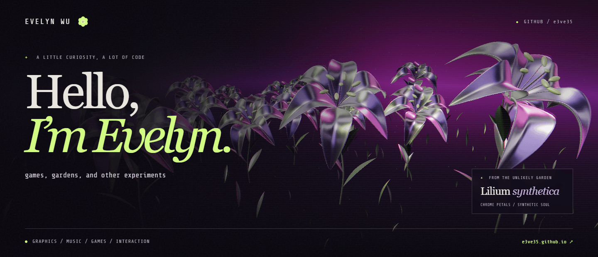

  <a href="https://e3ve35.github.io/">Enter the garden ↗</a> &nbsp;·&nbsp;
  <a href="https://e3ve35.github.io/#work">Selected work</a> &nbsp;·&nbsp;
  <a href="https://www.linkedin.com/in/evelynn-wu/">LinkedIn</a> &nbsp;·&nbsp;
  <a href="mailto:e3ve35@gmail.com">Say hello</a>

 

01 / THE PERSON BEHIND THE GARDEN

### Curious about what code can become.

I explore the space between **computer graphics**, **computer music**, and the joy of making things interactive. My projects range from visual music tools and procedural game worlds to augmented reality gardens and creative tools.

I’m a software engineer at **Snap**, previously at **TikTok**, with an MS in Computer Science from **Carnegie Mellon** and a BA from **NYU**. Alongside my creative work, I build data systems, ML experimentation infrastructure, and tools for learning and discovery.

 

02 / SELECTED PROJECTS

### Ways to play.

Start with **[Unlikely Garden](https://e3ve35.github.io/)**: a playable field of chrome flowers, synthesized sound, and a little curiosity.

| Project | Field notes |
| :--- | :--- |
| **[01 / Graphical Music Interface](https://github.com/e3ve35/GOMI)** | COMPUTER MUSIC / INTERACTION Compose music through a visual canvas and hear your changes in real time. [Try GOMI ↗](https://e3ve35.github.io/GOMI/) |
| **[02 / SharePix](https://github.com/e3ve35/SharePix)** | CREATIVE TOOLS / PIXEL ART Make and share pixel art, with drawing tools, saved drafts, and a social feed. |
| **[03 / Random Island Generator](https://github.com/e3ve35/random_island_generator)** | PROCEDURAL GENERATION / WORLDS Generate natural-looking game environments with customizable maps. |
| **[04 / Garden on the Desk](https://github.com/e3ve35/ar_garden)** | AUGMENTED REALITY / PLAY Plant a miniature garden through your webcam using speech and AR interaction. |
| **[05 / Maze Generator & Solver](https://github.com/e3ve35/maze_generator)** | ALGORITHMS / EXPLORATION Generate and solve mazes with Sidewinder, Wilson’s, Random Walk, and Aldous–Broder. |
| **[06 / Evolution of Video Games](https://github.com/e3ve35/game-evolution-datavis)** | DATA VISUALIZATION / STORIES Explore the history of video games through connected views and interactive filters. |

 

03 / TOOLS & MATERIALS

### A few things I build with.

**Code** &nbsp; Python · C++ · Java · TypeScript / JavaScript · SQL 
**AI & data** &nbsp; PyTorch · TensorFlow.js · Airflow · PySpark · BigQuery 
**Interfaces & infrastructure** &nbsp; React · Django · GCP

 

---

  
    
  BOTANICAL FORM. SYNTHETIC SOUL.
    
  <a href="mailto:e3ve35@gmail.com">A question, an idea, or something you’d like to make. ↗</a>

